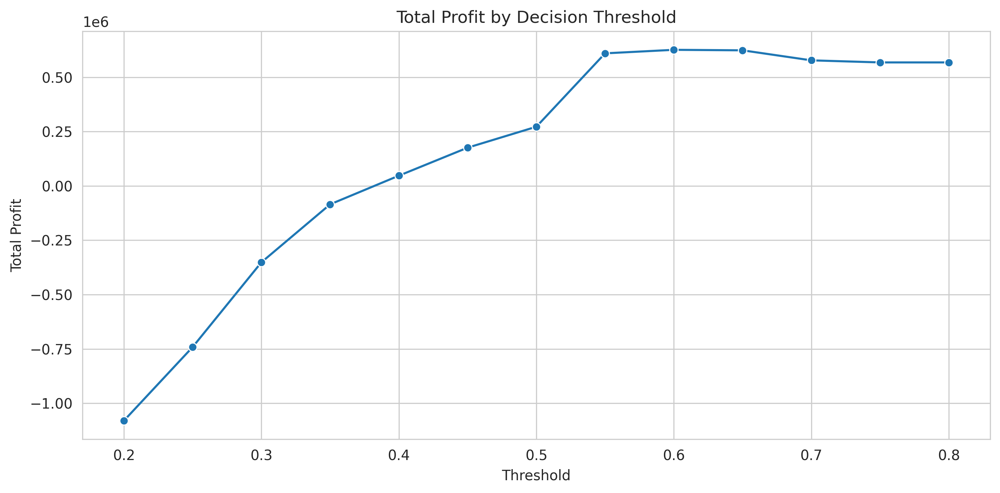

# 💳 Credit Risk & Scoring Analysis

### End-to-End Machine Learning Projekt für datengetriebene Kreditentscheidungen

> **Ziel:** Entwicklung eines Scoring-Systems zur **Risikominimierung**, **Profitmaximierung** und **Fairness-Analyse** im Kreditvergabeprozess

---

## 🧭 Problemstellung

Finanzinstitute stehen vor einem zentralen Zielkonflikt:

* Kreditausfälle minimieren
* Profit maximieren
* Gleichzeitig faire Entscheidungen treffen

**Kernfrage dieses Projekts:**

> Wie kann ein datengetriebenes Modell Kreditentscheidungen gleichzeitig **präziser**, **profitabler** und **fairer** machen als traditionelle Score-Systeme?

---

## 💡 Lösungsansatz

Dieses Projekt bildet eine **realistische End-to-End Credit Risk Pipeline** ab:

1. **Datenaufbereitung & Feature Engineering**
2. **Explorative Datenanalyse (EDA)**
3. **Vergleich eines bestehenden Score-Systems**
4. **Training eines Machine Learning Modells**
5. **Modellinterpretation (Feature Importance)**
6. **Business Simulation (Profit & Threshold Optimierung)**
7. **Fairness-Analyse**
8. **Management-tauglicher Final Report**

---

## 📊 Key Results (Business & Model Impact)

### 📉 Deutlich bessere Risikotrennung

Das neue Modell segmentiert Kunden signifikant besser nach Ausfallwahrscheinlichkeit als das Basissystem.

<p align="center">
  
</p>

---

### 💰 Klare wirtschaftliche Hebel identifiziert

* Einkommen und Debt-to-Income Ratio sind zentrale Treiber
* Niedriges Einkommen → signifikant höheres Risiko

<p align="center">
  
</p>

---

### 🤖 Modell ist erklärbar (kein Black Box Risiko)

Top Features im Modell:

* Debt-to-Income Ratio
* Einkommen
* Kredit-Score
* Liquidität

<p align="center">
  
</p>

---

### 📈 Profit-Optimierung durch Threshold-Steuerung

Ein kritischer Business-Hebel:

> Der optimale Decision Threshold liegt bei **~0.55 – 0.65**

→ Direkter Einfluss auf Profitabilität und Risikoexposition

<p align="center">
  
</p>

---

## 🧠 Zentrale Erkenntnisse

* ✅ Machine Learning übertrifft klassische Scorekarten deutlich
* ✅ Finanzielle Kennzahlen dominieren die Risikoprognose
* ⚖️ Fairness vs. Profit stellt einen realen Zielkonflikt dar
* 🎯 Threshold-Tuning ist der wichtigste operative Hebel
* 📊 Modellentscheidungen sind transparent und interpretierbar

---

## 🏗️ Projektarchitektur

```text
notebooks/
├── 01_data_generation.ipynb        # Simulation realistischer Kreditdaten
├── 02_data_cleaning.ipynb         # Datenbereinigung & Feature Engineering
├── 03_eda.ipynb                  # Explorative Analyse
├── 04_scoring_comparison.ipynb   # Vergleich Alt vs. Neu Score
├── 05_default_risk_model.ipynb   # ML-Modell (Classification)
├── 06_model_interpretation.ipynb # Feature Importance & Explainability
├── 07_fairness_and_business_impact.ipynb
├── 08_final_report.ipynb         # Management Summary

data/
├── raw/
└── processed/

images/
reports/
```

---

## ⚙️ Technologien

* Python (Pandas, NumPy, Scikit-learn)
* Data Visualization (Matplotlib, Seaborn)
* Machine Learning (Classification Models)
* Model Interpretation (Feature Importance)
* Business Simulation (Profit & Threshold Optimization)

---

## 💼 Relevanz für Unternehmen

Dieses Projekt ist direkt übertragbar auf:

* Banken (Credit Risk & Scoring)
* Versicherungen (Risk Assessment)
* FinTechs (Automatisierte Kreditentscheidungen)

---

## 👤 Autor

**Jan Momberg**
Data Science | Risk Analytics | Machine Learning

