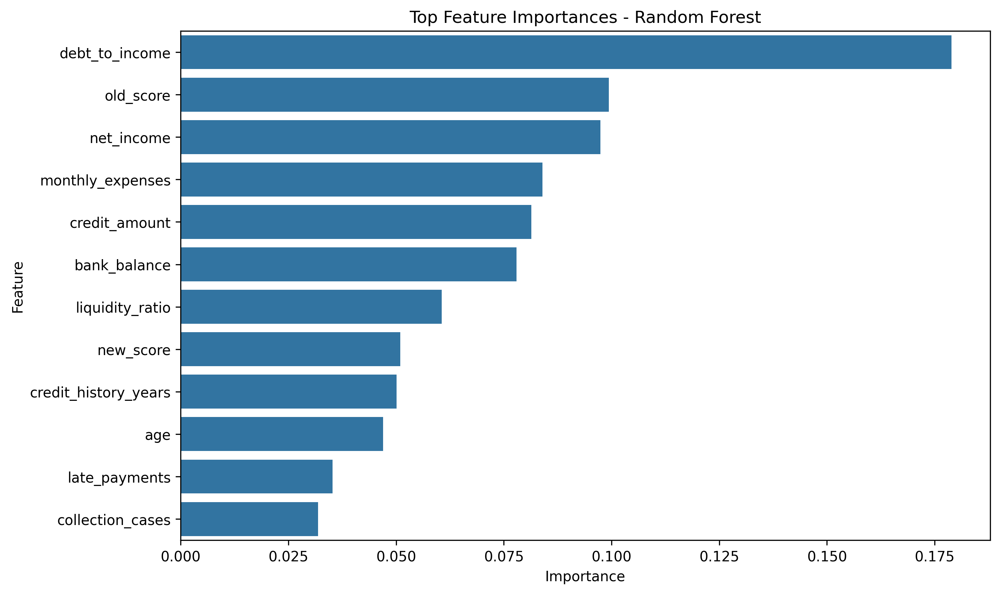

# 💳 Credit Risk & Scoring Analysis

> End-to-End Data Science Projekt zur Optimierung von Kreditentscheidungen  
> Fokus: **Risk Modeling, Profit Maximization und Fairness**

---

## 🚀 Projektüberblick

Dieses Projekt simuliert einen realistischen Entscheidungsprozess in Banken und zeigt, wie **Datenanalyse, Machine Learning und Business-Logik** kombiniert werden, um bessere Kreditentscheidungen zu treffen.

**Zentrale Fragestellung:**

> Wie kann ein Kreditmodell Risiko minimieren, Profit maximieren und gleichzeitig fair bleiben?

---

## 🧠 Business Impact

Dieses Projekt adressiert zentrale Herausforderungen im Banking:

- 📉 Reduktion von Kreditausfällen (Default Risk)
- 💰 Maximierung des erwarteten Profits
- ⚖️ Analyse von Fairness und Bias im Scoring
- 📊 Transparenz durch Modellinterpretation

---

## 📊 Key Insights

### 📉 Score vs Default Risk

Höhere Scores führen zu deutlich geringeren Ausfallraten → das Scoring-Modell ist effektiv

<p align="center">
  
</p>

---

### 💰 Income vs Risk

Niedriges Einkommen ist signifikant mit höherem Default-Risiko verbunden

<p align="center">
  
</p>

---

### 🤖 Model Understanding (Feature Importance)

Die wichtigsten Einflussfaktoren im Modell:

- Debt-to-Income Ratio  
- Einkommen  
- Kredit-Score  
- Liquidität  

<p align="center">
  
</p>

---

### 📈 Business Impact (Threshold Optimierung)

Die Wahl des Entscheidungs-Thresholds hat einen erheblichen Einfluss auf den Profit.  
Der optimale Bereich liegt bei ca. **0.55 – 0.65**

<p align="center">
  
</p>

---

## 📈 Zentrale Erkenntnisse

- Das neue Score-System trennt Risiko-Gruppen deutlich besser als das alte
- Finanzielle Kennzahlen sind die stärksten Prädiktoren für Default
- Machine Learning verbessert Kreditentscheidungen signifikant
- Fairness und Profit stehen teilweise im Zielkonflikt
- Der Decision Threshold ist der wichtigste Business-Hebel

---

## 🏗️ Projektstruktur

```text
notebooks/
├── 01_data_generation.ipynb
├── 02_data_cleaning.ipynb
├── 03_eda.ipynb
├── 04_scoring_comparison.ipynb
├── 05_default_risk_model.ipynb
├── 06_model_interpretation.ipynb
├── 07_fairness_and_business_impact.ipynb
└── 08_final_report.ipynb

data/
├── raw/
└── processed/

images/
reports/


⚙️ Technologien
Python (Pandas, NumPy, Scikit-learn)
Data Visualization (Matplotlib, Seaborn)
Machine Learning (Classification Models)
Model Interpretation (Feature Importance)
Business Simulation (Profit & Threshold Optimization)

▶️ How to Run

git clone https://github.com/jan-momberg/schufa-score-analyse.git
cd schufa-score-analyse
pip install -r requirements.txt

💼 Relevanz für Unternehmen
Dieses Projekt ist direkt übertragbar auf:
Banken (Credit Risk & Scoring)
Versicherungen (Risk Assessment)
FinTechs (Automatisierte Kreditentscheidungen)


👤 Autor
Jan Momberg
Data Science | Risk Analytics | Machine Learning
