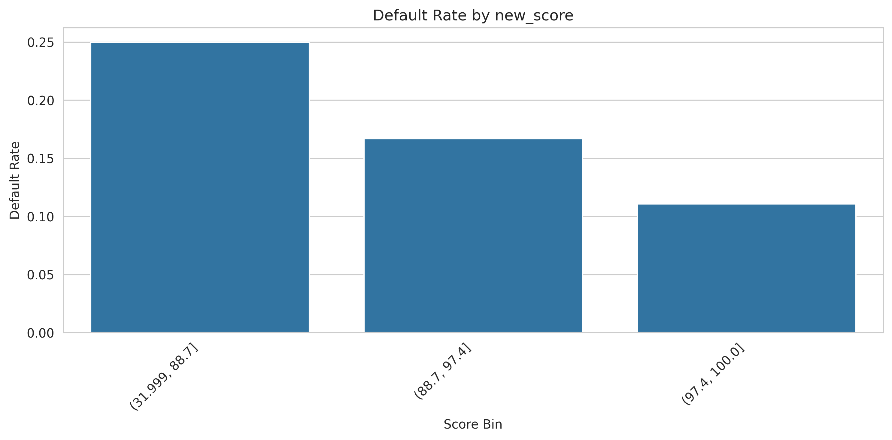

# 💳 Credit Risk & Scoring Analysis

End-to-end Data Science Projekt zur Analyse von Kreditentscheidungen, Scoring-Systemen und Ausfallrisiken.

Dieses Projekt simuliert einen realistischen Entscheidungsprozess von Banken und zeigt, wie Daten, Machine Learning und Business-Logik zusammenwirken, um bessere Kreditentscheidungen zu treffen.

---

## 🎯 Ziel des Projekts

Ziel ist es zu verstehen:

**Wie kann ein Kreditentscheidungssystem gleichzeitig Risiko minimieren, Profit maximieren und fair bleiben?**

Dazu wird eine vollständige Analysepipeline aufgebaut:

- Datengenerierung  
- Datenbereinigung  
- Explorative Analyse  
- Score-Vergleich  
- Machine Learning Modell  
- Fairness & Business Impact  

---

## 🧠 Zentrale Business-Fragen

- Wie gut sagen Scores tatsächliche Kreditausfälle voraus?  
- Ist das neue Score-System besser als das alte?  
- Welche Faktoren treiben Risiko wirklich?  
- Wo entstehen Fairness-Probleme?  
- Welche Entscheidungsstrategie maximiert Profit?  

---

## 📊 Key Insights

### 📉 Score vs Default Risk

Höhere Scores führen zu deutlich geringeren Ausfallraten → Score funktioniert



---

### 💰 Income vs Risk

Niedriges Einkommen ist mit höherem Default-Risiko verbunden


---

### 🤖 Model Understanding (Feature Importance)

Wichtigste Einflussfaktoren im Modell:

- Debt-to-Income Ratio  
- Einkommen  
- Score  
- Liquidität  


---

### 📈 Business Impact (Threshold Optimierung)

Die Wahl des Entscheidungs-Thresholds beeinflusst den Profit erheblich  
Optimaler Bereich liegt ungefähr zwischen **0.55 und 0.65**


---

## 📈 Wichtigste Erkenntnisse

- Das neue Score-System trennt Risiko-Gruppen besser als das alte  
- Finanzielle Kennzahlen sind die wichtigsten Prädiktoren für Default  
- Machine Learning verbessert Kreditentscheidungen signifikant  
- Fairness und Profit stehen teilweise im Zielkonflikt  
- Der Decision Threshold ist der wichtigste Business-Hebel  

---

## 💼 Business Value

Dieses Projekt zeigt:

- datengetriebene Kreditentscheidungen  
- Kombination von Machine Learning und Business Logik  
- Optimierung von Risiko und Profit  
- Transparenz durch Modellinterpretation  
- Anwendung auf reale Banking-Use-Cases  

---

## 🏗️ Projektstruktur

```text
notebooks/
├── 01_data_generation.ipynb
├── 02_data_cleaning.ipynb
├── 03_eda.ipynb
├── 04_scoring_comparison.ipynb
├── 05_default_risk_model.ipynb
├── 06_model_interpretation.ipynb
├── 07_fairness_and_business_impact.ipynb
└── 08_final_report.ipynb

data/
├── raw/
└── processed/

images/
reports/
