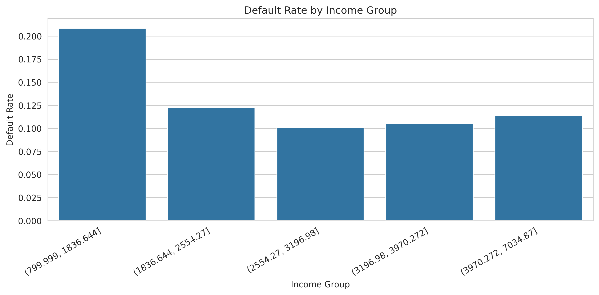

# 💳 Credit Risk & Scoring Analysis (Schufa-Style Project)

End-to-end Data Science Projekt zur Analyse von Kreditentscheidungen, Scoring-Systemen und Ausfallrisiken.

Dieses Projekt simuliert einen realistischen Entscheidungsprozess von Banken und zeigt, wie Daten, Modelle und Business-Logik zusammenwirken.

---

## 🚀 Live Capabilities

* Credit Risk Modeling
* Scoring System Evaluation
* Business Impact Optimization
* Fairness Analysis

---

## 📌 Projektüberblick

Ziel dieses Projekts ist es, ein vollständiges Kreditrisiko-System zu analysieren:

* Entwicklung eines synthetischen Kreditdatensatzes
* Vergleich eines alten vs. neuen Score-Systems
* Aufbau eines Default-Risk-Modells
* Interpretation der Modellentscheidungen
* Analyse von Fairness und Business Impact
* Ableitung von Geschäftsentscheidungen

---

## 🧠 Business-Fragestellungen

* Wie gut sagen Scores tatsächliche Kreditausfälle voraus?
* Ist das neue Score-System besser als das alte?
* Welche Faktoren treiben Kreditrisiko wirklich?
* Wo entstehen Fairness-Probleme?
* Welche Entscheidungsstrategie maximiert Profit?

---

## 📊 Key Insights

### Score vs Default Risk


### Income & Risk Relationship



### Model Performance / Feature Importance


### Business Impact (Threshold Analysis)


---

## 🏗️ Projektstruktur

```
notebooks/
│
├── 01_data_generation.ipynb
├── 02_data_cleaning.ipynb
├── 03_eda.ipynb
├── 04_scoring_comparison.ipynb
├── 05_default_risk_model.ipynb
├── 06_model_interpretation.ipynb
├── 07_fairness_and_business_impact.ipynb
└── 08_final_report.ipynb

data/
├── raw/
└── processed/

images/
reports/
```

---

## 🔄 Analyse-Pipeline

### 1. Data Generation

* Simulation realistischer Kreditdaten
* Features: Einkommen, Schulden, Scores, Verhalten
* Generierung von Default-Fällen

### 2. Data Cleaning

* Bereinigung und Validierung
* Feature Engineering
* Datenkonsistenz

### 3. Exploratory Data Analysis

* Verteilungen
* Default-Raten
* Risiko-Treiber

### 4. Scoring Comparison

* Vergleich: `old_score` vs `new_score`
* Analyse von Signalstärke und möglichen Bias

### 5. Default Risk Model

* Klassifikationsmodell zur Vorhersage von Ausfällen
* Nutzung finanzieller und Score-Variablen

### 6. Model Interpretation

* Feature Importance
* Einfluss einzelner Variablen
* Nachvollziehbarkeit der Entscheidungen

### 7. Fairness & Business Impact

* Analyse nach Gruppen (z. B. Einkommen)
* False Positives / False Negatives
* Profit-Optimierung

### 8. Final Report

* Management Summary
* KPI-Analyse
* Handlungsempfehlungen

---

## 📈 Ergebnisse (Kurzfassung)

* Das neue Score-System zeigt eine bessere Trennung von Risiko-Gruppen
* Einkommen und Liquidität sind zentrale Treiber für Default
* Negative Einträge haben starken Einfluss auf Entscheidungen
* Bestimmte Gruppen zeigen erhöhte Fehlklassifikationen
* Optimierte Thresholds können Profit signifikant steigern

---

## 💼 Business Value

Dieses Projekt zeigt:

* Wie datengetriebene Kreditentscheidungen funktionieren
* Wie Modelle in echte Geschäftsentscheidungen übersetzt werden
* Wie Fairness und Profit im Konflikt stehen können
* Wie man Risiko systematisch steuert

---

## ⚙️ Installation

```
pip install -r requirements.txt
```

Start:

```
jupyter notebook
```

---

## 🔐 Hinweis

Dieses Repository ist aktuell privat und dient als Portfolio-Projekt.
Zugriff erfolgt nur über Einladung.

---

## 🚀 Nächste Schritte

* Integration in ein Streamlit Dashboard
* Echtzeit-Datenanalyse
* Deployment als Entscheidungs-Tool
* Integration eines AI-Assistenten

---

## 👨‍💻 Autor

Projekt im Bereich:

* Data Science
* Kreditrisiko
* Machine Learning
* Business Analytics

